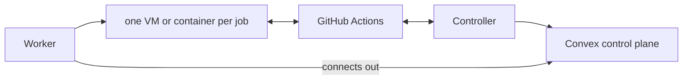

# EraInfra

[中文说明](README.zh-CN.md) · [infra.erasuite.dev](https://infra.erasuite.dev/)

EraInfra is a self-hosted CI fleet for GitHub Actions users with their own machines that gives
every job a fresh, isolated environment and needs no public IP or Kubernetes cluster. You add
Linux, Mac and Windows machines as Workers. A workflow names a Profile, EraInfra picks a ready
Worker, prepares an environment for that one job, and destroys it when the job ends.

|               |                                                                                                       |
| ------------- | ----------------------------------------------------------------------------------------------------- |
| Stage         | Pre-release. The project's own fleet has run its Linux jobs in Firecracker microVMs since 2026-08-20. |
| Version       | 0.2 release candidates, listed on the [releases page](https://github.com/Fanzzzd/erainfra/releases)   |
| Workers       | Linux x64 and ARM64, Apple Silicon macOS, Windows x64 (preview)                                       |
| Control plane | A Convex deployment you own                                                                           |
| License       | [MIT](LICENSE)                                                                                        |

## What using it looks like

A workflow changes one line:

```yaml
jobs:
  test:
    # was: runs-on: ubuntu-latest
    runs-on: erainfra-2vcpu-ubuntu-2404
```

`erainfra-2vcpu-ubuntu-2404` is a Profile: an executor, an image pinned by digest, a size and scale
bounds. A new deployment has no Profiles; the [Quick start](#quick-start) registers this one. GitHub
hands the queued job to the Profile's runner scale set, the Profile's controller creates an Attempt,
and the scheduler places it on a ready Worker with room. The Worker starts a fresh container or
microVM from the Profile's image with a single-use runner registration, then destroys it on every
exit path, including a Worker crash.

## Quick start

This path ends with a first job on one Linux machine, on the Docker executor. Docker jobs share the
host kernel, so use it only for a repository you trust, and see [Limits](#limits) for Firecracker.

You need:

- a workstation with Git, Node.js 22 or later, and pnpm 11.21.0, the version `package.json` pins
  (`corepack enable` installs it);
- a [Convex](https://www.convex.dev/) account;
- a Linux x64 or ARM64 machine with systemd, sudo, Docker Engine 28 or later, at least 2 CPUs and
  at least 9 GiB of memory (the scheduler leaves 10% of a machine free);
- a GitHub repository you administer, and a fine-grained personal access token for it with the
  Administration repository permission set to read and write.

1. Deploy the control plane from the newest release tag. Deploy from a tag, never from `main`: the
   backend pins the release that machines install. On your workstation:

   ```bash
   git clone https://github.com/Fanzzzd/erainfra.git && cd erainfra
   git checkout "$(git describe --tags --abbrev=0)"
   pnpm install --frozen-lockfile
   cd packages/backend
   npx convex dev --once    # signs you in, creates a Convex project, writes .env.local
   npx convex deploy -y     # deploys the functions to the project's production deployment
   ```

   `npx convex dashboard --prod --no-open` prints `https://dashboard.convex.dev/d/<deployment>`.
   `https://<deployment>.convex.site` then serves the dashboard and the installers.

2. Configure sign-in and the secrets, then upload the dashboard. Still in `packages/backend`:

   ```bash
   npx @convex-dev/auth --prod --web-server-url https://<deployment>.convex.site
   openssl rand -hex 32 > bootstrap-secret
   openssl rand -hex 32 > controller-token
   npx convex env set --prod BOOTSTRAP_SECRET "$(cat bootstrap-secret)"
   npx convex env set --prod CONTROLLER_TOKEN "$(cat controller-token)"
   pnpm run deploy --skip-convex   # builds the dashboard and uploads it to the deployment
   ```

   The first command sets `SITE_URL`, `JWT_PRIVATE_KEY` and `JWKS`. The auth files it asks about
   already exist in the repository; confirm and continue.

3. Open `https://<deployment>.convex.site`, choose **First run**, and create the first admin
   account with the contents of `bootstrap-secret`.

4. Copy `controller-token` to the Linux machine, save the GitHub token beside it as `github-token`,
   and prepare the machine:

   ```bash
   chmod 600 controller-token github-token
   sudo usermod -aG docker "$USER"   # the Worker runs docker as you
   printf 'vm.max_map_count = 262144\nfs.inotify.max_user_instances = 1280\n' |
     sudo tee /etc/sysctl.d/60-erainfra-worker.conf && sudo sysctl --system
   ```

   A Worker below these [two kernel settings](docs/workers.md#linux-worker-prerequisites) refuses
   Docker jobs. Log out of every session and back in, so the docker group applies, then run
   `sudo loginctl enable-linger "$USER"` so the Worker's user service runs without a login.

5. Register the Profile. On the same machine, look up the digest of the newest published image,
   then install a controller for your repository:

   ```bash
   digest=$(docker buildx imagetools inspect ghcr.io/fanzzzd/runner-center-ubuntu-24.04-js:edge \
     --format '{{.Manifest.Digest}}')
   curl -fsSL https://<deployment>.convex.site/install | sudo bash -s -- --role controller \
     --profile erainfra-2vcpu-ubuntu-2404 --executor docker --vcpus 2 --memory-mib 8192 \
     --image-release "ghcr.io/fanzzzd/runner-center-ubuntu-24.04-js@$digest" \
     --github-config-url https://github.com/<owner>/<repository> \
     --controller-token-file "$PWD/controller-token" --github-token-file "$PWD/github-token" \
     --no-prompt
   ```

   The **Runner Profiles** table on the dashboard's **Machines** page now lists the Profile, and
   its controller shows as listening.

6. Add the machine as a Worker. In the dashboard, open **Machines**, choose **Add machine**, keep
   **Linux or macOS**, and run the command it shows on the machine as your own user, without
   `sudo`, within 15 minutes. The Worker pulls the Profile's image and reports the Profile ready
   when its checks pass. In a new shell, `rc status` shows it and `rc logs -f` follows it.

7. Change a workflow in the repository to `runs-on: erainfra-2vcpu-ubuntu-2404` and push. The job
   appears on the dashboard's **Runs** page.

For production, use a GitHub App instead of a personal access token and run controllers on several
Workers, as [Profile controllers](docs/controllers.md) describes.

## What works today

- Workflows target a Profile with `runs-on: <profile>`. Controllers use GitHub's Runner Scale Set
  Client with single-use JIT registrations, for repository and organization scale sets, and can
  run on several Workers under a lease so a Profile keeps listening when one host stops.
- Each job gets a fresh environment, torn down on every exit path, including a Worker crash.
- A Worker proves its isolation before it takes work. One whose live firewall rules drift from the
  rendered policy, or whose containers misreport their CPU and memory limits, stops being ready.
- A Profile's egress can be public, audited, or limited to an allowlist of domains and address
  ranges ([Job isolation and egress](docs/job-isolation.md)).
- An optional router job sends a run to GitHub-hosted runners when the Profile has no free Worker.
- On Firecracker Profiles, a [job cache](docs/job-cache.md) serves `actions/cache`, `setup-*`
  caching, BuildKit, Turborepo and Go from S3-compatible storage you choose.
- The dashboard, the `erainfra` CLI and an HTTP API show Workers, Profiles, runs, per-job CPU and
  memory charts, size recommendations and JUnit test results. The control plane also exports
  Prometheus metrics and sends alerts to Slack or a webhook.
- Installers verify every binary they install against a SHA-256 pinned in the deployment.
- The same control plane can deploy long-lived Apps to Nodes
  ([Infrastructure management](docs/infra-management.md)).

| Platform            | Executor    | Isolation                 | Status                                                    |
| ------------------- | ----------- | ------------------------- | --------------------------------------------------------- |
| Linux x64 and ARM64 | Firecracker | own guest kernel per job  | Supported. Use it for untrusted code. Needs KVM.          |
| Linux x64 and ARM64 | Docker      | shared host kernel        | Supported for jobs that trust each other.                 |
| Apple Silicon macOS | Tart        | copy-on-write VM per job  | Supported. Two VMs per machine by default.                |
| Windows x64         | Hyper-V     | VM per job, one at a time | Preview. The provisioner has not yet run on real Hyper-V. |

## Limits

- The control plane runs on Convex. While the deployment is unreachable, no new job is scheduled.
- EraInfra has no stable release yet. Upgrading a running fleet is a cutover that moves the backend
  and the controllers together ([runbook](docs/runbooks/deploy-control-plane.md)).
- Firecracker Workers need `/dev/kvm` and two dedicated block devices, or a sparse file for
  evaluation. Docker jobs share the Worker's kernel, so a Docker Profile is for trusted jobs only.
- The default Linux image carries a smaller tool set than GitHub's `ubuntu-latest`. The conformance
  workflow lists every difference ([Image Releases](docs/images.md)).
- The job cache and test results work only on Firecracker; job metrics cover Linux only.
- Enterprise scale sets need a dedicated controller with a classic personal access token, because
  a GitHub App cannot register enterprise runners.
- Self-hosted runners run repository code with that repository's token and secrets. Keep Profiles
  private to trusted repositories, pin Actions by commit SHA, and do not run pull requests from
  untrusted forks on machines that hold persistent credentials.

## How it compares

| Alternative                | Choose it when                                                     | Where EraInfra differs                                                                                                   |
| -------------------------- | ------------------------------------------------------------------ | ------------------------------------------------------------------------------------------------------------------------ |
| GitHub-hosted runners      | You want nothing to operate, or need GitHub's full hosted image.   | Runs on hardware you already own, and can send a run to GitHub-hosted runners when your Workers are busy.                |
| A plain self-hosted runner | You have one trusted repository and one machine.                   | A plain runner reuses its host between jobs. EraInfra prepares an environment for one job and removes it afterwards.     |
| Actions Runner Controller  | Your fleet already runs Kubernetes. It is the better choice there. | Needs no cluster, and covers Macs, Windows hosts and machines behind NAT. Both use GitHub's scale-set protocol.          |
| Fireactions                | You need Firecracker runners on Linux and nothing else.            | EraInfra uses Fireactions as the reference for its Linux executor and puts Linux, macOS and Windows under one scheduler. |

## How it works

Convex holds the fleet's state, schedules Attempts, serves the installers and hosts the dashboard.
A controller turns a Profile's GitHub job demand into Attempts, and a Worker runs each Attempt in
a new environment. Every machine connects out to Convex, so none needs a public IP or open port.



[How EraInfra works](docs/architecture.md) has the details, [CONTEXT.md](CONTEXT.md) the terms,
and [docs/adr](docs/adr) the decisions.

## Documentation

- [How EraInfra works](docs/architecture.md): components, scheduling, security properties.
- [Deploy and configure the control plane](docs/control-plane.md): deployment variables.
- [Workers](docs/workers.md): adding machines and what each platform needs.
- [Profile controllers](docs/controllers.md): registering Profiles, host labels, GitHub permissions.
- [Use Profiles in workflows](docs/workflows.md): `runs-on`, migration, fallback, Experiments.
- [Job isolation and egress](docs/job-isolation.md): what each job gets and is denied.
- [The job cache](docs/job-cache.md): caches served to Firecracker jobs.
- [Image Releases](docs/images.md): the default image and how its pins move.
- [The erainfra CLI and operator API](docs/cli.md): tokens, commands, routes.
- [Job metrics, test results and exit reasons](docs/job-insights.md): per-Attempt data.
- [Monitor the fleet](docs/monitoring.md): Prometheus metrics and alerts.
- [Infrastructure management](docs/infra-management.md): Nodes, Apps, gateways and the mesh.

Runbooks for operators:

- [Deploy the control plane](docs/runbooks/deploy-control-plane.md) to a running fleet.
- [Operate Profile controllers](docs/runbooks/operate-the-controller-host.md).
- [Move a Profile to Firecracker](docs/runbooks/firecracker-cutover.md).
- [Restrict a Profile's egress](docs/runbooks/restrict-job-egress.md).
- [Run the job cache](docs/runbooks/operate-the-job-cache.md) and [a registry mirror](docs/runbooks/operate-the-registry-mirror.md).
- [Take the only Worker out of service](docs/runbooks/take-the-only-worker-away.md).

## Develop

You need Node.js 22 or later, pnpm 11.21.0, Go 1.27.4 or later (as `go.mod` names), and a Convex account or local
deployment; `apps/mesh` also needs rustup. Run `pnpm install`, then `pnpm check`: it runs lint, the
format check, type checks and every package's tests, including the Go tests.
[CONTRIBUTING.md](CONTRIBUTING.md) lists the Go and Rust gates CI adds and the commit rules, and
[Releases](docs/releases.md) describes how versions are cut.

## License

EraInfra is released under the [MIT License](LICENSE).
