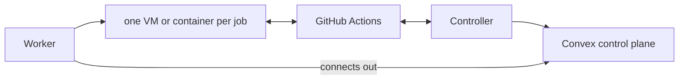

# EraInfra

[English](README.md) · [infra.erasuite.dev](https://infra.erasuite.dev/)

EraInfra 是一套自托管的 CI 机群，面向自己有机器的 GitHub Actions 用户，为每个 job 提供全新的隔离环境，不需要公网 IP，也不需要 Kubernetes 集群。你把 Linux、Mac 和 Windows 机器加进来作为 Worker。workflow 指定一个 Profile，EraInfra 选一台就绪的 Worker，只为这一个 job 准备环境，job 结束后销毁。

|          |                                                                                     |
| -------- | ----------------------------------------------------------------------------------- |
| 阶段     | 预发布。项目自己的机群从 2026-08-20 起在 Firecracker microVM 里运行全部 Linux job。 |
| 版本     | 0.2 候选版本，见 [releases 页面](https://github.com/Fanzzzd/erainfra/releases)      |
| Worker   | Linux x64 和 ARM64、Apple Silicon macOS、Windows x64（预览）                        |
| 控制平面 | 你自己的 Convex deployment                                                          |
| 许可证   | [MIT](LICENSE)                                                                      |

## 用起来是什么样

workflow 只改一行：

```yaml
jobs:
  test:
    # was: runs-on: ubuntu-latest
    runs-on: erainfra-2vcpu-ubuntu-2404
```

`erainfra-2vcpu-ubuntu-2404` 是一个 Profile：一个 executor、一个按 digest 固定的镜像、一个规格和扩缩上下限。新的 deployment 里没有任何 Profile，[快速开始](#快速开始)会注册这一个。GitHub 把排队的 job 交给这个 Profile 的 runner scale set，Profile 的 controller 创建一个 Attempt，调度器把它放到一台有空位的就绪 Worker 上。Worker 用 Profile 的镜像启动一个全新的容器或 microVM，配一次性的 runner 注册，无论 job 以何种方式结束（包括 Worker 崩溃）都会销毁它。

## 快速开始

按这条路径走完，你会在一台 Linux 机器上用 Docker executor 跑通第一个 job。Docker job 共享宿主机内核，所以只用于你信任的仓库；Firecracker 见[限制](#限制)。

你需要：

- 一台工作机，装有 Git、Node.js 22 或更高版本、pnpm 11.21.0（即 `package.json` 固定的版本，`corepack enable` 会安装它）；
- 一个 [Convex](https://www.convex.dev/) 账号；
- 一台 Linux x64 或 ARM64 机器，带 systemd、sudo、Docker Engine 28 或更高版本，至少 2 个 CPU、至少 9 GiB 内存（调度器会给每台机器留出 10% 不用）；
- 一个你有管理员权限的 GitHub 仓库，以及该仓库的 fine-grained personal access token，其 Administration 仓库权限设为 read and write。

1. 从最新的 release tag 部署控制平面。只从 tag 部署，不要从 `main` 部署：后端固定了机器要安装的 release。在工作机上执行：

   ```bash
   git clone https://github.com/Fanzzzd/erainfra.git && cd erainfra
   git checkout "$(git describe --tags --abbrev=0)"
   pnpm install --frozen-lockfile
   cd packages/backend
   npx convex dev --once    # signs you in, creates a Convex project, writes .env.local
   npx convex deploy -y     # deploys the functions to the project's production deployment
   ```

   `npx convex dashboard --prod --no-open` 会打印 `https://dashboard.convex.dev/d/<deployment>`。之后由 `https://<deployment>.convex.site` 提供 dashboard 和安装脚本。

2. 配置登录和密钥，然后上传 dashboard。仍在 `packages/backend` 下：

   ```bash
   npx @convex-dev/auth --prod --web-server-url https://<deployment>.convex.site
   openssl rand -hex 32 > bootstrap-secret
   openssl rand -hex 32 > controller-token
   npx convex env set --prod BOOTSTRAP_SECRET "$(cat bootstrap-secret)"
   npx convex env set --prod CONTROLLER_TOKEN "$(cat controller-token)"
   pnpm run deploy --skip-convex   # builds the dashboard and uploads it to the deployment
   ```

   第一条命令会设置 `SITE_URL`、`JWT_PRIVATE_KEY` 和 `JWKS`。它询问的 auth 文件仓库里已经有了，确认后继续即可。

3. 打开 `https://<deployment>.convex.site`，选择 **First run**，用 `bootstrap-secret` 的内容创建第一个管理员账号。

4. 把 `controller-token` 复制到 Linux 机器上，把 GitHub token 存到同一目录下的 `github-token`，然后准备这台机器：

   ```bash
   chmod 600 controller-token github-token
   sudo usermod -aG docker "$USER"      # the Worker runs docker as you; log out and back in after
   sudo loginctl enable-linger "$USER"  # keeps the Worker's user service running without a login
   printf 'vm.max_map_count = 262144\nfs.inotify.max_user_instances = 1280\n' |
     sudo tee /etc/sysctl.d/60-erainfra-worker.conf && sudo sysctl --system
   ```

   达不到这[两项内核参数](docs/workers.md#linux-worker-prerequisites)的 Worker 会拒绝 Docker job。

5. 注册 Profile。在同一台机器上查出最新发布镜像的 digest，然后为你的仓库安装一个 controller：

   ```bash
   digest=$(docker buildx imagetools inspect ghcr.io/fanzzzd/runner-center-ubuntu-24.04-js:edge \
     --format '{{.Manifest.Digest}}')
   curl -fsSL https://<deployment>.convex.site/install | sudo bash -s -- --role controller \
     --profile erainfra-2vcpu-ubuntu-2404 --executor docker --vcpus 2 --memory-mib 8192 \
     --image-release "ghcr.io/fanzzzd/runner-center-ubuntu-24.04-js@$digest" \
     --github-config-url https://github.com/<owner>/<repository> \
     --controller-token-file "$PWD/controller-token" --github-token-file "$PWD/github-token" \
     --no-prompt
   ```

   这时 dashboard **Machines** 页面的 **Runner Profiles** 表里会列出这个 Profile，它的 controller 显示为 listening。

6. 把这台机器加为 Worker。在 dashboard 里打开 **Machines**，选择 **Add machine**，保持 **Linux or macOS**，在 15 分钟内以你自己的用户（不加 `sudo`）在机器上运行它给出的命令。Worker 会拉取 Profile 的镜像，检查通过后报告该 Profile 就绪。打开一个新的 shell，`rc status` 可以查看状态，`rc logs -f` 可以跟踪日志。

7. 把仓库里某个 workflow 改成 `runs-on: erainfra-2vcpu-ubuntu-2404` 并推送。这个 job 会出现在 dashboard 的 **Runs** 页面。

用于生产时，改用 GitHub App 代替 personal access token，并在多台 Worker 上运行 controller，做法见 [Profile controllers](docs/controllers.md)。

## 目前可用的功能

- workflow 用 `runs-on: <profile>` 指定 Profile。controller 使用 GitHub 的 Runner Scale Set Client 和一次性 JIT 注册，支持仓库级和组织级 scale set；controller 可以在租约下运行在多台 Worker 上，一台主机停掉时 Profile 仍在监听。
- 每个 job 都有全新的环境，无论以何种方式结束（包括 Worker 崩溃）都会被拆除。
- Worker 先证明自己的隔离，再接活。实际防火墙规则偏离渲染出的策略，或容器报告的 CPU、内存限额与实际不符时，Worker 就不再就绪。
- Profile 的出站流量可以是公开、审计，或只允许列表中的域名和地址段（[Job 隔离和出站流量](docs/job-isolation.md)）。
- 可选的路由 job 在 Profile 没有空闲 Worker 时，把这次运行转到 GitHub 托管的 runner。
- 在 Firecracker Profile 上，[job 缓存](docs/job-cache.md)用你选定的 S3 兼容存储为 `actions/cache`、`setup-*` 缓存、BuildKit、Turborepo 和 Go 提供缓存。
- dashboard、`erainfra` CLI 和 HTTP API 展示 Worker、Profile、运行记录、每个 job 的 CPU 和内存图表、规格建议以及 JUnit 测试结果。控制平面还导出 Prometheus 指标，并向 Slack 或 webhook 发送告警。
- 安装脚本用 deployment 中固定的 SHA-256 校验它安装的每个二进制文件。
- 同一个控制平面还可以把长期运行的 App 部署到 Node 上（[基础设施管理](docs/infra-management.md)）。

| 平台                | Executor    | 隔离方式                   | 状态                                            |
| ------------------- | ----------- | -------------------------- | ----------------------------------------------- |
| Linux x64 和 ARM64  | Firecracker | 每个 job 独立的 guest 内核 | 支持。运行不受信任的代码用它。需要 KVM。        |
| Linux x64 和 ARM64  | Docker      | 共享宿主机内核             | 支持，限于彼此信任的 job。                      |
| Apple Silicon macOS | Tart        | 每个 job 一个写时复制 VM   | 支持。默认每台机器两个 VM。                     |
| Windows x64         | Hyper-V     | 每个 job 一个 VM，一次一个 | 预览。provisioner 尚未在真实 Hyper-V 上运行过。 |

## 限制

- 控制平面运行在 Convex 上。deployment 无法访问期间，不会调度新的 job。
- EraInfra 还没有稳定版。升级正在运行的机群是一次切换，后端和 controller 要一起更新（[runbook](docs/runbooks/deploy-control-plane.md)）。
- Firecracker Worker 需要 `/dev/kvm` 和两块专用块设备；仅用于评估时可以用稀疏文件代替。Docker job 共享 Worker 的内核，所以 Docker Profile 只用于受信任的 job。
- 默认 Linux 镜像带的工具比 GitHub 的 `ubuntu-latest` 少。conformance workflow 列出了每一处差异（[Image Release](docs/images.md)）。
- job 缓存和测试结果只在 Firecracker 上可用；job 指标只覆盖 Linux。
- 企业级 scale set 需要一台专用 controller 主机和 classic personal access token，因为 GitHub App 不能注册企业级 runner。
- 自托管 runner 会用仓库自己的 token 和 secrets 运行仓库代码。Profile 只开放给受信任的仓库，Action 按 commit SHA 固定，不要在持有长期凭据的机器上运行来自不受信任 fork 的 pull request。

## 与其他方案对比

| 替代方案                  | 何时选它                                               | EraInfra 的不同之处                                                                                   |
| ------------------------- | ------------------------------------------------------ | ----------------------------------------------------------------------------------------------------- |
| GitHub 托管的 runner      | 你什么都不想运维，或需要 GitHub 完整的托管镜像。       | 运行在你已有的硬件上，你的 Worker 忙时还能把运行转到 GitHub 托管的 runner。                           |
| 普通的自托管 runner       | 你只有一个受信任的仓库和一台机器。                     | 普通 runner 在多个 job 之间复用同一台主机。EraInfra 只为一个 job 准备环境，用完即删。                 |
| Actions Runner Controller | 你的机群已经运行在 Kubernetes 上。这时它是更好的选择。 | 不需要集群，还能覆盖 Mac、Windows 主机和 NAT 后面的机器。两者都使用 GitHub 的 scale set 协议。        |
| Fireactions               | 你只需要 Linux 上的 Firecracker runner。               | EraInfra 以 Fireactions 作为 Linux executor 的参考，并把 Linux、macOS 和 Windows 放在同一个调度器下。 |

## 工作原理

Convex 保存机群状态、调度 Attempt、提供安装脚本并托管 dashboard。controller 把一个 Profile 在 GitHub 上的 job 需求转成 Attempt，Worker 在全新的环境里运行每个 Attempt。每台机器都主动向外连接 Convex，所以都不需要公网 IP 或开放端口。



细节见 [How EraInfra works](docs/architecture.md)，术语见 [CONTEXT.md](CONTEXT.md)，决策记录见 [docs/adr](docs/adr)。

## 文档

以下文档均为英文。

- [How EraInfra works](docs/architecture.md)：组件、调度、安全特性。
- [Deploy and configure the control plane](docs/control-plane.md)：deployment 变量。
- [Workers](docs/workers.md)：添加机器，以及各平台的要求。
- [Profile controllers](docs/controllers.md)：注册 Profile、主机标签、GitHub 权限。
- [Use Profiles in workflows](docs/workflows.md)：`runs-on`、迁移、回退、Experiment。
- [Job isolation and egress](docs/job-isolation.md)：每个 job 得到什么、被禁止什么。
- [The job cache](docs/job-cache.md)：为 Firecracker job 提供的缓存。
- [Image Releases](docs/images.md)：默认镜像及其版本固定如何更新。
- [The erainfra CLI and operator API](docs/cli.md)：token、命令、路由。
- [Job metrics, test results and exit reasons](docs/job-insights.md)：每个 Attempt 的数据。
- [Monitor the fleet](docs/monitoring.md)：Prometheus 指标和告警。
- [Infrastructure management](docs/infra-management.md)：Node、App、gateway 和 mesh。

运维 runbook：

- [Deploy the control plane](docs/runbooks/deploy-control-plane.md)：向正在运行的机群部署控制平面。
- [Operate Profile controllers](docs/runbooks/operate-the-controller-host.md)：运维 Profile controller。
- [Move a Profile to Firecracker](docs/runbooks/firecracker-cutover.md)：把 Profile 迁到 Firecracker。
- [Restrict a Profile's egress](docs/runbooks/restrict-job-egress.md)：限制 Profile 的出站流量。
- [Run the job cache](docs/runbooks/operate-the-job-cache.md) 和 [a registry mirror](docs/runbooks/operate-the-registry-mirror.md)：运行 job 缓存和镜像仓库镜像。
- [Take the only Worker out of service](docs/runbooks/take-the-only-worker-away.md)：下线唯一的 Worker。

## 开发

你需要 Node.js 22 或更高版本、pnpm 11.21.0、Go 1.27.4 或更高版本（以 `go.mod` 为准），以及一个 Convex 账号或本地 deployment；`apps/mesh` 还需要 rustup。先运行 `pnpm install`，再运行 `pnpm check`：它会执行 lint、格式检查、类型检查和每个包的测试，包括 Go 测试。[CONTRIBUTING.md](CONTRIBUTING.md) 列出了 CI 额外运行的 Go 和 Rust 检查以及提交规则，[Releases](docs/releases.md) 说明如何发版。

## 许可证

EraInfra 采用 [MIT 许可证](LICENSE)发布。
